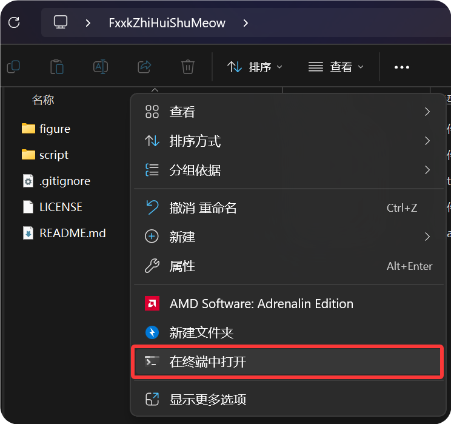
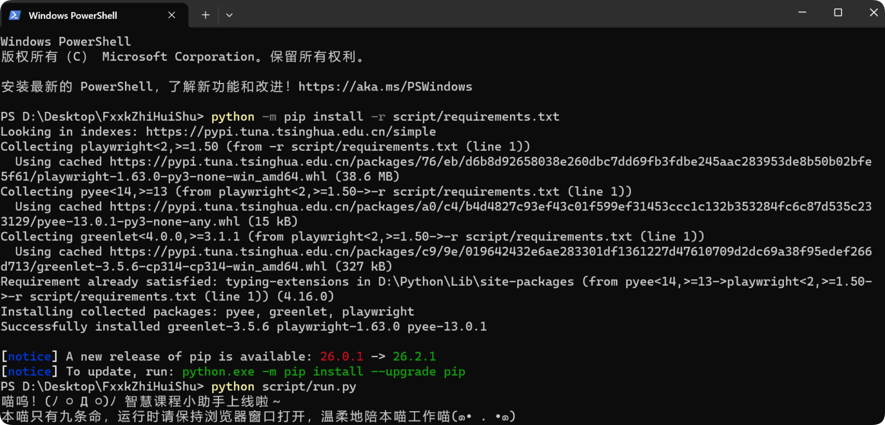
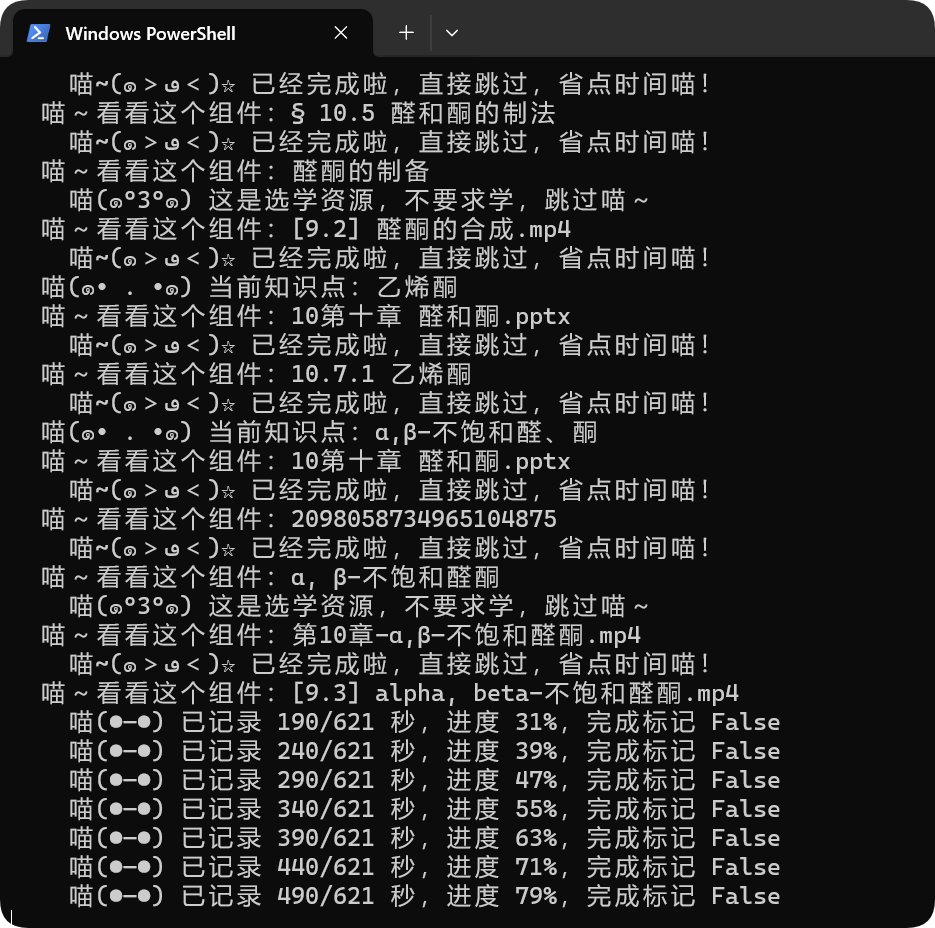

# [FxxkZhiHuiShuMeow] Sonamiの智慧树智慧课程刷课脚本

分支版本：<br>
[mhpmc / ZhiHuiShuMeow2.0](https://github.com/mhpmc/ZhiHuiShuMeow2.0)<br>
在本项目的智慧课程刷课功能上，额外集成了翻转课的刷客功能；

[Liang1jp / zhihuishu4.0](https://github.com/Liang1jp/zhihuishu4.0)<br>
在2.0的基础上，额外集成了基于前端的对共享课的支持。

## 前置库依赖安装



在项目根目录，右键打开 PowerShell，**`Ctrl+V` 粘贴以下指令**：
```powershell
python -m pip install -r script/requirements.txt
```

之后运行：

```powershell
python script/run.py
```
<br><br>
*注：默认使用 MicroSoft Edge ；如果您使用 Chrome 浏览器，可加 `--channel chrome`（完整命令为下面这个）：*
```powershell
python script/run.py --channel chrome
```

之后，终端界面会像下图这样；



在打开的浏览器中，自行使用 `知到APP` 扫码登录。

**⚠WARNING 不要同时运行多个脚本 ⚠**

## Fxxk智慧树喵

之后，脚本便会**自动开始刷课**：



后台保持运行，可以直接最小化窗口后去干别的事。<br>
*注：但是**不要**把脚本终端界面或打开的浏览器关掉*

可以定期打开脚本窗口观赏猫猫的工作日志。<br>
如果遇到界面报错，就类似下面这样的：

```error
喵qwq 本次运行已停止：xxxxx。结果已经保存到xxxxx
```

直接关掉脚本，过段时间后重新打开即可。

## 一些附加功能（不重要）

`--interval 2` 调整批次间隔，支持 0.5～60 秒；<br>
`--login-timeout 1800` 调整等待登录时间。

按 `Ctrl+C` 可以强制停止脚本运行。

已在脚本中登陆过一次后，后续重新打开脚本会免登录**直接登入**；<br>
想登出请运行：

```powershell
python script/run.py --fresh-login
```